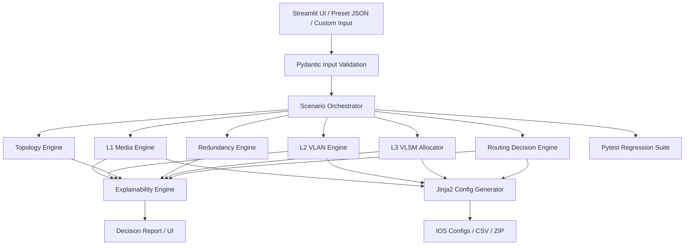
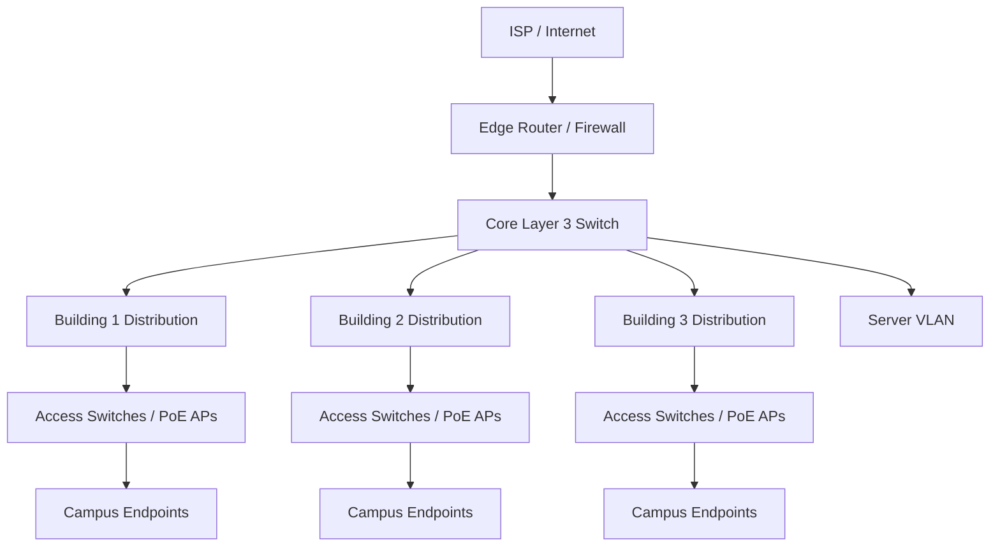
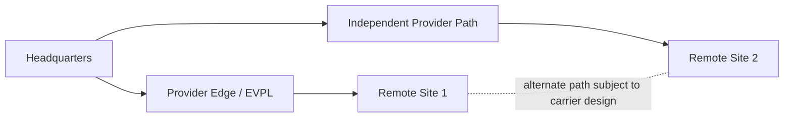
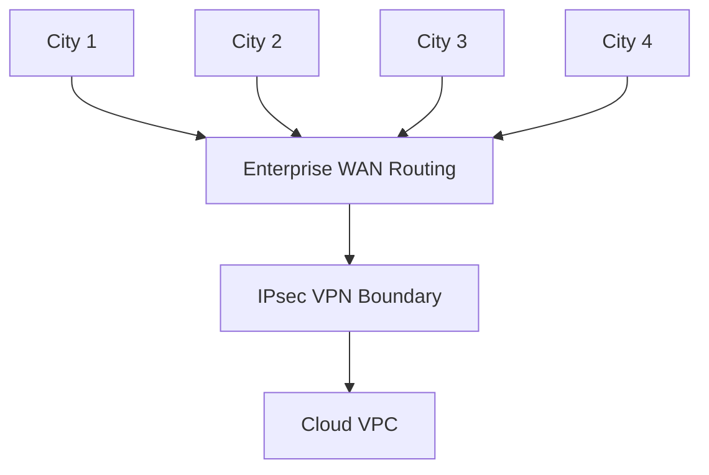

# NetArchitect — System Architecture

## 1. Architectural objective

NetArchitect is an explainable automated network architect, not merely a subnet calculator or CLI text generator. It ingests a preset or custom scenario, evaluates requirements through deterministic decision engines, computes addressing, recommends topology and routing, produces configuration artifacts, and records why each decision was made.

## 2. Layered architecture

## 3. Core modules

| Module | Responsibility | Main checks/output |
|---|---|---|
| `models.py` | Typed scenario and requirement schemas | Types, bounds, IPv4 root |
| `input_validator.py` | Validates preset/custom input | Pydantic validation errors |
| `media_engine.py` | Cat6a/OM4/OS2 selection | 100 m and 400 m bands; copper violation |
| `vlan_engine.py` | VLAN plan validation | ID range, duplicate IDs/names |
| `topology_engine.py` | Profile-specific architecture recommendation | Campus/MAN/WAN rationale and caveats |
| `redundancy_engine.py` | Resiliency recommendations | Dual path, uplink and failover test guidance |
| `vlsm_engine.py` | Bitwise IPv4 VLSM allocation | Largest-first, masks, wildcard, gateway, broadcast, capacity, overlap |
| `routing_engine.py` | OSPF/Multi-Area OSPF/eBGP choice | Assignment conditions and unresolved cases |
| `explainability_engine.py` | Decision trace | Input basis, choice, rationale, reference, assumptions |
| `config_generator.py` | Renders Jinja2 IOS artifacts | Switch, SVI, router, ACL, IPsec planning and route-summarization outputs |
| `project_engine.py` | Coordinates all engines | Single analysis result object |

## 4. End-to-end decision flow

1. User selects Campus LAN, Metro MAN, Global WAN or Custom.
2. Pydantic validates field types and allowed ranges.
3. L1 engine selects medium from the maximum link distance:
   - 0–100 m: Cat6a / 10GBASE-T
   - 101–400 m: OM4 / 10GBASE-SR / 850 nm
   - over 400 m: OS2 / 10GBASE-LR/ER, with optical-budget verification required
4. L2 engine validates VLAN IDs and names.
5. Topology and redundancy engines select the profile design and explain caveats.
6. VLSM sorts host requests descending and allocates aligned non-overlapping blocks.
7. Routing engine applies the assignment's routing decision conditions.
8. Explainability engine records every selected decision and the supplied input basis.
9. Jinja2 renders configuration baselines only where the input is sufficient.
10. User downloads the report, subnet table and configuration bundle.
11. Pytest checks calculations, boundaries and generated output invariants.

## 5. Campus LAN logical architecture

Redundant uplinks should be physically diverse where possible and controlled with an appropriate Layer 2 loop-prevention or routed design. Exact device count and port mapping depend on endpoint placement and selected hardware.

## 6. Metro MAN logical architecture

The assignment specifies HQ plus two remote sites, 15–35 km, EVPL, sub-5 ms target and dual-homed failover. Carrier path diversity and measured latency must be confirmed; topology alone cannot guarantee the latency target.

## 7. Global WAN logical architecture

The assignment calls for four cities plus a Cloud VPC, IPsec VPN, multi-area OSPF/BGP and route summarization. Actual BGP peerings, AS numbers, VPN endpoints, crypto suites and prefix policies require deployment-specific inputs.

## 8. Important design boundaries

- Preset data in the assignment does not specify exact device models, IOS versions or interface inventories.
- It does not provide OSPF area IDs/subnet-to-area mappings, ABR placement, BGP ASNs/peer addresses/policies, or a least-privilege ACL policy.
- The program must explain these missing inputs and avoid inventing production configuration.
- A generated config is not simulator-verified until loaded into Packet Tracer/GNS3 and tested.
